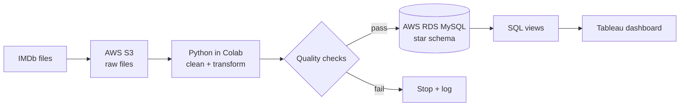

# TV Show Cancellation Analytics Pipeline

**Can you tell from season 1 that a TV show will end early?**

A data pipeline that takes IMDb's public data (13M titles, 10M episodes), stores it in a
cloud warehouse on AWS, checks its quality on every load, and shows the answers in a Tableau dashboard.

## The idea

Streaming teams (like Netflix's content team) ask two questions before backing a show:
**which past shows is it like, and how did they do?** This project answers that with public IMDb data.

## What I found

- **A weak pilot is the clearest warning sign.** Modern shows with short first seasons that ended
  early had a median pilot rating of **7.2**, against **7.6** for long-running shows.
- **8 in 10 thrillers and sci-fi shows ended early**, but fewer than 2 in 10 talk and game shows did.
  Overall, 54% of shows ended early.
- **Viewers dropping off during season 1 didn't predict anything.** That first looked like a signal,
  but it disappeared once shows with similar season lengths were compared fairly.

## How it works

| Tool | What it does here |
|---|---|
| **AWS S3** | Keeps the original raw files, by date, so any run can be repeated |
| **AWS RDS (MySQL)** | The data warehouse the dashboard reads from |
| **Python (pandas)** | Cleans, labels and transforms the data |
| **SQL** | Creates the tables, loads them safely, and prepares the dashboard data |
| **Tableau** | The dashboard |

## The data model

A **star schema**: "fact" tables hold the numbers, "dimension" tables describe them.

- `fact_episode`: one row per episode (rating, votes)
- `fact_series_season`: one row per show per season
- `dim_series`, `dim_genre`: the shows and their genres (a bridge table links them, since a show can have 3 genres)
- `mart_comps`: each show's 10 most similar shows
- `run_log`, `dq_results`: a record of every pipeline run and its quality checks

## Data quality

- Every load is checked first. If a serious check fails, nothing is loaded.
- Bad rows are set aside in S3, not silently dropped (9 in v1).
- Loads are **safe to repeat**: running the 985K-row load twice gave exactly the same tables.

## How "ended early" was defined

IMDb has no "cancelled" flag, so I defined it: **ended by 2025, with 2 seasons or fewer and 26 episodes
or fewer.** It took three tries. The first rule wrongly flagged long anime (numbered as one season);
the second wrongly flagged short-season streaming hits like Squid Game.

## Limitations

- No viewing data (it's private), so IMDb votes stand in for audience size.
- "Ended early" includes some planned endings (e.g. Fleabag), not only cancellations.
- Ratings are today's totals, not those at the time a show aired.

## How to run

Open **[`TV_Project.ipynb`](TV_Project.ipynb)** in Google Colab and run the cells in order.
You need an AWS S3 bucket and an RDS MySQL database.

## Next steps

- Run the pipeline automatically every week on AWS (Lambda, Glue, Step Functions)
- Add automated tests
- Improve the "similar shows" matching

---

